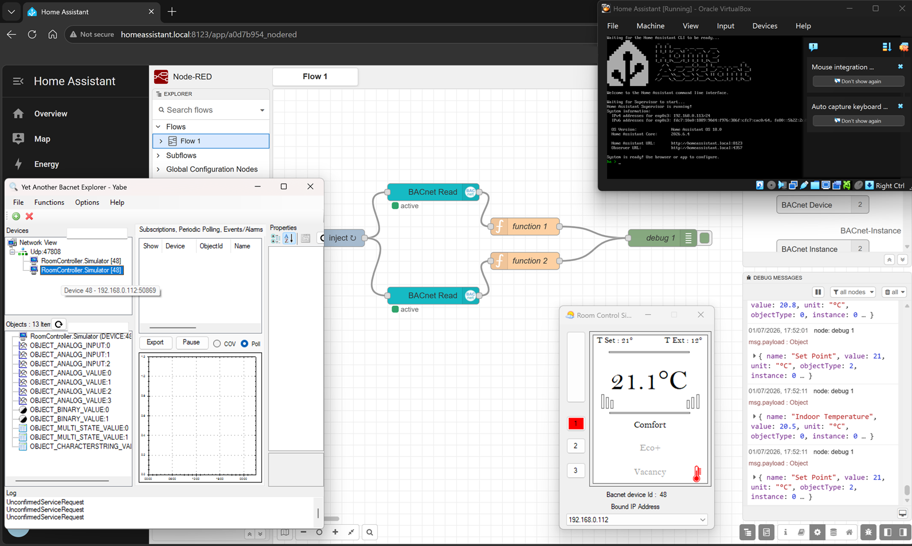
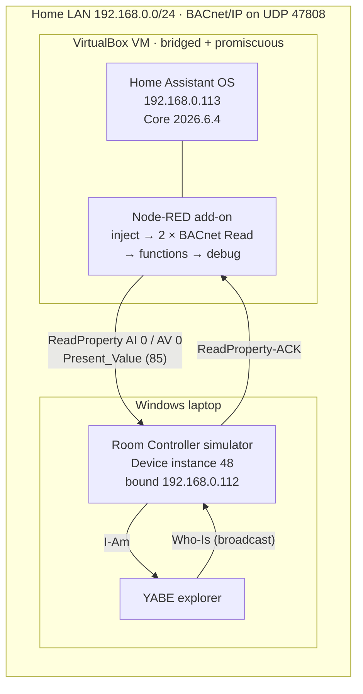
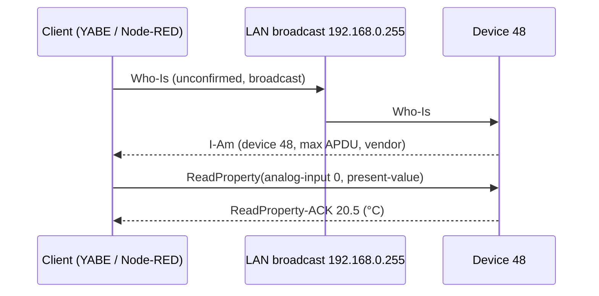
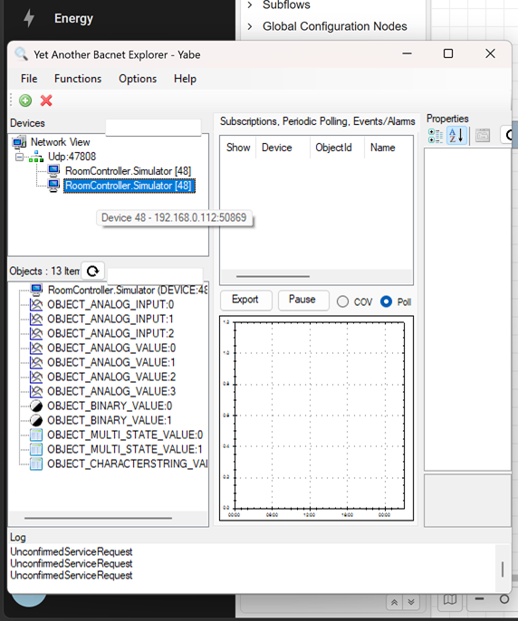
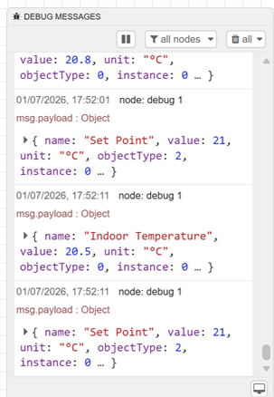

# BACnet/IP Network Explorer

**Hands-on BACnet/IP lab: discovering a simulated room controller with YABE, then reading its objects from a supervisory set-up (Home Assistant + Node-RED in a VirtualBox VM). Covers Who-Is/I-Am, ReadProperty, and BACnet's object model compared with Modbus registers.**

[](https://www.youtube.com/channel/UC5Cupmz7vlfcodpCX7k8iuQ)
[](https://github.com/the-control-cabinet)
-blue)


> **The short version:** a YABE Room Controller simulator (**device instance 48**, bound to 192.168.0.112) was discovered on UDP 47808 and exposed **13 objects**. A Home Assistant VM in VirtualBox (192.168.0.113) ran Node-RED with two BACnet Read nodes. They returned live **Indoor Temperature (Analog Input 0) = 20.5-20.8 °C** and **Set Point (Analog Value 0) = 21 °C**, with units and object types. Getting there meant solving the classic BACnet/IP problem: broadcasts not reaching a virtual machine. The fix was a bridged adapter, promiscuous mode, and the correct interface and broadcast address.



**Portfolio position:** Stage 1, Protocol Foundations · Field level. Related projects: [Modbus TCP Data Collector](https://github.com/the-control-cabinet/modbus-tcp-data-collector) · [Mains Water Metering (Modbus RTU)](https://github.com/the-control-cabinet/mains-water-metering-modbus-rtu)

---

## Contents

1. [Objective](#1-objective)
2. [Scope](#2-scope)
3. [Deliverables](#3-deliverables)
4. [System architecture](#4-system-architecture)
5. [Results at a glance](#5-results-at-a-glance)
6. [Points list](#6-points-list)
7. [Issues dealt with](#7-issues-dealt-with-summary)
8. [Testing](#8-testing-summary)
9. [Outputs](#9-outputs)
10. [Benefits](#10-benefits)
11. [Video](#11-video)
12. [Quick start](#12-quick-start)
13. [Repository map](#13-repository-map)
14. [Roadmap](#14-roadmap)
15. [Skills demonstrated](#15-skills-demonstrated-bms--building-automation)
16. [Disclaimer and licence](#16-disclaimer-and-licence)

---

## 1. Objective

Build practical experience with **BACnet/IP**, the dominant open protocol in commercial BMS (Trend, Siemens, Tridium/Niagara and most VAV/FCU controllers).

Specific goals:

- **Discover** devices with Who-Is / I-Am and understand device instances.
- **Read** object properties with ReadProperty, especially `Present_Value` (property 85).
- Learn the **object model**: Analog Input/Value, Binary Value, Multi-state Value and the rest.
- Reach the device from a **supervisory environment** (HA + Node-RED) running in a separate virtual machine, as a head-end would on a real network.
- Contrast BACnet with Modbus.

## 2. Scope

| In scope | Out of scope (for now) |
|---|---|
| BACnet/IP over the home LAN, UDP 47808 | BACnet MS/TP (RS485) field buses |
| YABE + Room Controller simulator (device 48) | Real Trend, Siemens or Tridium hardware |
| Home Assistant OS in VirtualBox with the Node-RED add-on | Graphics, schedules, trend logs |
| Who-Is / I-Am discovery; ReadProperty on AI and AV objects | WriteProperty, COV subscriptions, alarms (roadmap) |
| VM networking for broadcasts (bridged + promiscuous) | BBMDs and routing between subnets |

## 3. Deliverables

| # | Deliverable | Where | Status |
|---|---|---|---|
| D1 | Node-RED BACnet read flow (two objects) | [docs/01](docs/01-setup-and-networking.md#node-red-flow), [config/](config/) | ✅ Built. Flow export to be added ([config/README.md](config/README.md)) |
| D2 | Lab and VM networking set-up | [docs/01](docs/01-setup-and-networking.md) | ✅ |
| D3 | Device object list and points list | [docs/02](docs/02-objects-and-properties.md), [data/](data/object-list.csv) | ✅ |
| D4 | Commissioning and test record | [docs/03](docs/03-commissioning-and-test-record.md) | ✅ |
| D5 | Issues log and lessons learned | [docs/04](docs/04-issues-and-lessons-learned.md) | ✅ |
| D6 | Skills mapping | [docs/05](docs/05-skills.md) | ✅ |
| D7 | Screenshot evidence | [images/](images/) | ✅ |

## 4. System architecture



**How discovery and a read work on the wire:**



## 5. Results at a glance

| Measure | Result (from the captured evidence) |
|---|---|
| Device discovered | `RoomController.Simulator [48]` on `Udp:47808`, address 192.168.0.112:50869 |
| Objects exposed | **13**: Device, AI 0-2, AV 0-3, BV 0-1, MSV 0-1, CharacterString Value |
| Read 1 | `{ name: "Indoor Temperature", value: 20.5 → 20.8, unit: "°C", objectType: 0, instance: 0 }` |
| Read 2 | `{ name: "Set Point", value: 21, unit: "°C", objectType: 2, instance: 0 }` |
| Simulator panel at the time | T Set 21°, T Ext 12°, display 21.1 °C, mode Comfort |
| Supervisor | HA OS VM 192.168.0.113 (VirtualBox), Node-RED add-on |
| Date of capture | 1 July 2026, 17:52 |

<p align="center">


</p>

## 6. Points list

| Point | Object | Instance | Property | Units | Access tested | Value read |
|---|---|---|---|---|---|---|
| Indoor Temperature | Analog Input (0) | 0 | Present_Value (85) | °C | Read | 20.5 → 20.8 |
| Set Point | Analog Value (2) | 0 | Present_Value (85) | °C | Read | 21 |
| Others listed by YABE | AI 1-2, AV 1-3, BV 0-1, MSV 0-1, CSV | n/a | n/a | n/a | Discovered, not read | n/a |

The full object list is in [data/object-list.csv](data/object-list.csv). Values are simulator data.

## 7. Issues dealt with (summary)

| # | Issue | Fix |
|---|---|---|
| 1 | Who-Is from the VM finds nothing | VirtualBox NIC on **Bridged Adapter** (not NAT) with **Promiscuous Mode: Allow All** |
| 2 | Node-RED BACnet nodes fail with a SERVICES error | Client interface set to the VM's own IP (192.168.0.113) and the broadcast address to 192.168.0.255 |
| 3 | Wrong or empty values | Address by object type + instance + property ID (`Present_Value` = 85), not like a register |
| 4 | Most of the time lost on networking | BACnet/IP faults are usually Layer 2/3 (broadcasts, NAT, firewalls), not the BACnet configuration |

Full write-ups: [docs/04-issues-and-lessons-learned.md](docs/04-issues-and-lessons-learned.md)

## 8. Testing (summary)

Full record: [docs/03-commissioning-and-test-record.md](docs/03-commissioning-and-test-record.md)

- **Discovery:** YABE found device 48 on UDP 47808 and listed its 13 objects.
- **Supervisor reach:** the HA VM on 192.168.0.113 could talk to the simulator on 192.168.0.112 once bridged and in promiscuous mode.
- **ReadProperty:** both Node-RED reads returned value, units and object type. The temperature was seen changing (20.5 → 20.8 °C).
- **Repeatability:** the inject repeats, so reads were logged about every 10 s (17:52:01, 17:52:11) with consistent results.

## 9. Outputs

- Structured JSON per point (name, value, units, object type, instance), ready for HA entities, MQTT or a trend log.
- A working supervisor → field-device read path across separate hosts.
- A documented VM networking recipe for BACnet/IP labs.

## 10. Benefits

- **Core BMS protocol:** BACnet/IP is what most commercial sites run on. Discovery, object lists and ReadProperty are day-one commissioning tasks.
- **Network awareness:** shows I understand that BACnet/IP relies on broadcasts, which is the root of many real site faults (VLANs, NAT, missing BBMDs).
- **Protocol breadth:** a direct comparison with the [Modbus TCP](https://github.com/the-control-cabinet/modbus-tcp-data-collector) and [Modbus RTU](https://github.com/the-control-cabinet/mains-water-metering-modbus-rtu) work.
- **Safe lab:** a simulator and an isolated VM before touching a live Trend or Niagara system.

## 11. Video

📺 [The Control Cabinet on YouTube](https://www.youtube.com/channel/UC5Cupmz7vlfcodpCX7k8iuQ). A walkthrough of this lab is planned.

<!-- Replace with the episode link once published: [▶ Watch](https://youtu.be/VIDEO_ID) -->
| Topic | Video |
|---|---|
| BACnet/IP from scratch: YABE, a simulator, and why your VM can't see it | Coming soon |

## 12. Quick start

1. Install **YABE** on Windows and start its **Room Controller simulator**. Note its device instance and bound IP.
2. In YABE, add a **BACnet/IP over UDP** channel on port 47808 (0xBAC0) and check that the device appears.
3. Run **Home Assistant OS in VirtualBox**. Set **Network → Adapter 1 → Bridged Adapter**, **Promiscuous Mode: Allow All**.
4. In HA, install the **Node-RED** add-on, then add `node-red-contrib-bacnet` via **Manage palette**.
5. Configure the BACnet client: interface = the VM's IP, broadcast = your subnet broadcast (e.g. 192.168.0.255).
6. Add **BACnet Read** nodes for AI 0 and AV 0, property `Present_Value` (85). Wire inject → read → function → debug, then deploy.
7. Or import [config/flows.json](config/flows.json) once the real export has been added.

## 13. Repository map

```
.
├── README.md
├── CHANGELOG.md
├── LICENSE
├── config/
│   ├── README.md            ← how to export/import the flow
│   └── flows.json           ← placeholder until the real export is added
├── data/
│   └── object-list.csv
├── docs/
│   ├── 01-setup-and-networking.md
│   ├── 02-objects-and-properties.md
│   ├── 03-commissioning-and-test-record.md
│   ├── 04-issues-and-lessons-learned.md
│   └── 05-skills.md
└── images/
    ├── project-2-screenshot.png
    ├── yabe-discovery.png
    ├── node-red-debug.png
    └── room-controller-simulator.png
```

## 14. Roadmap

- [ ] Add the real Node-RED flow export to `config/flows.json`.
- [ ] **WriteProperty**: change the setpoint (AV 0) from Node-RED, with priority-array awareness (priority 8 vs 16, relinquish).
- [ ] **COV subscription** on the temperature instead of polling.
- [ ] Read the BV and MSV objects and map their states (occupancy and mode).
- [ ] Bring the points into HA as entities and trend them (links to the alarm and trend strategy project).
- [ ] Compare against the Trend IQ411 on the portfolio rig.

## 15. Skills demonstrated (BMS / building automation)

| Skill | Evidence |
|---|---|
| BACnet/IP discovery | Who-Is / I-Am; device 48 and its 13 objects listed in YABE |
| Object model | AI, AV, BV, MSV, CSV identified; property 85 used for reads |
| ReadProperty | Two live reads with units and object types |
| Network fault finding | VM broadcast issue solved (bridged, promiscuous, interface and broadcast) |
| Supervisor-to-field architecture | HA + Node-RED head-end on a separate host |
| Handover documentation | Points list, object list, commissioning record, issues log |

## 16. Disclaimer and licence

A personal learning and portfolio project on a simulator, not for production use. [MIT Licence](LICENSE).

*Built and documented by James, July 2026 · part of [The Control Cabinet BMS portfolio](https://github.com/the-control-cabinet).*
