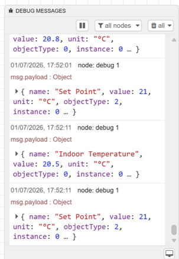

# 01 · Set-up and Networking

[← Back to README](../README.md)

## Lab layout

| Component | Host | Address | Notes |
|---|---|---|---|
| Room Controller simulator | Windows laptop | 192.168.0.112 (UDP port 50869 shown by YABE) | BACnet device instance **48** |
| YABE (Yet Another BACnet Explorer) | Windows laptop | UDP 47808 channel | Discovery and object browsing |
| Home Assistant OS | VirtualBox VM | **192.168.0.113/24** (`enp0s3`) | Core 2026.6.4, `homeassistant.local:8123` |
| Node-RED | HA add-on inside the VM | n/a | `node-red-contrib-bacnet` |

BACnet/IP uses **UDP port 47808** (hex 0xBAC0) by default. Discovery relies on **broadcasts** to the subnet, which is the root of most lab and site problems.

> **Simulator port:** YABE listed the simulator at 192.168.0.112:**50869**, not 47808. The simulator answered from its own port, and YABE and Node-RED still reached it because a client replies to the address and port each device reports when it answers. On site, always record the full address of each device (IP and port).

## VirtualBox network settings that made discovery work

| Setting | Value | Why |
|---|---|---|
| Attached to | **Bridged Adapter** (the laptop's active NIC) | NAT hides the VM behind the host and drops inbound broadcasts |
| Promiscuous Mode | **Allow All** (or Allow VMs) | Lets broadcast frames for the subnet reach the VM's NIC |
| Result | VM gets its own LAN IP (192.168.0.113) | It sits on the same broadcast domain as the simulator |

## Node-RED BACnet client configuration

| Field | Value |
|---|---|
| Interface | The VM's own IP: 192.168.0.113 |
| Broadcast address | 192.168.0.255 (subnet broadcast for /24) |
| Port | 47808 |
| Device | Instance 48 (config node "BACnet Device") |

## Node-RED flow

| Node | Role |
|---|---|
| `inject` (repeating) | Triggers the reads; captured at 10 s intervals |
| `BACnet Read` #1 | Analog Input 0 → Present_Value (Indoor Temperature) |
| `BACnet Read` #2 | Analog Value 0 → Present_Value (Set Point) |
| `function 1` / `function 2` | Shape each result into `{ name, value, unit, objectType, instance }` |
| `debug 1` | Shows both results |
| Config nodes | **BACnet Device** and **BACnet Instance**, each used by 2 nodes, plus the BACnet client |

## Order of start-up that works

1. Start the Room Controller simulator and check its device ID (48) and bound IP.
2. Confirm discovery in YABE first (an independent check, like the second Modbus client in the Modbus TCP project).
3. Start the HA VM, bridged and in promiscuous mode, and confirm it has a LAN IP on the same subnet.
4. Deploy the Node-RED flow and watch debug.
