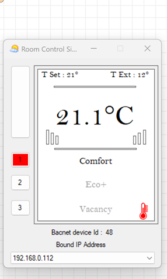

# 02 · Objects, Properties and Points List

[← Back to README](../README.md) · Data: [`data/object-list.csv`](../data/object-list.csv)

## Device 48: object list as discovered in YABE (13 objects)

| # | Object | Type no. | Instance | Read in this lab | Value |
|---|---|---|---|---|---|
| 1 | Device | 8 | 48 | Discovery (I-Am) | `RoomController.Simulator` |
| 2 | Analog Input | 0 | 0 | ✅ Present_Value | 20.5 → 20.8 °C ("Indoor Temperature") |
| 3 | Analog Input | 0 | 1 | Listed | n/a |
| 4 | Analog Input | 0 | 2 | Listed | n/a |
| 5 | Analog Value | 2 | 0 | ✅ Present_Value | 21 °C ("Set Point") |
| 6 | Analog Value | 2 | 1 | Listed | n/a |
| 7 | Analog Value | 2 | 2 | Listed | n/a |
| 8 | Analog Value | 2 | 3 | Listed | n/a |
| 9 | Binary Value | 5 | 0 | Listed | n/a |
| 10 | Binary Value | 5 | 1 | Listed | n/a |
| 11 | Multi-state Value | 19 | 0 | Listed | n/a |
| 12 | Multi-state Value | 19 | 1 | Listed | n/a |
| 13 | CharacterString Value | 40 | 0 | Listed | n/a |

The simulator's own panel at the same moment showed **T Set 21°**, **T Ext 12°**, room **21.1 °C** and mode **Comfort** (buttons 1/2/3 = Comfort / Eco+ / Vacancy). The unread objects very likely carry those (outside temperature, mode, occupancy), but that wasn't confirmed by reading them. Reading them is on the roadmap.

## Key properties

| Property | ID | Meaning |
|---|---|---|
| Object_Identifier | 75 | Object type + instance (unique within the device) |
| Object_Name | 77 | Human-readable name, e.g. "Indoor Temperature" |
| Object_Type | 79 | AI, AV, BV… |
| **Present_Value** | **85** | The live value: what a BMS reads and commands |
| Units | 117 | Engineering units carried by the object itself |
| Priority_Array | 87 | 16 command priorities on commandable objects (relevant when writing) |

## Common object types

| Type | No. | Typical use |
|---|---|---|
| Analog Input | 0 | Measured values (temperature, pressure) |
| Analog Output | 1 | Modulating commands (valve, damper %) |
| Analog Value | 2 | Setpoints, calculated values |
| Binary Input | 3 | Status contacts (run, trip, filter) |
| Binary Output | 4 | Start/stop commands |
| Binary Value | 5 | Software flags, modes |
| Device | 8 | The controller itself |
| Multi-state Value | 19 | Enumerated states (Comfort / Eco / Vacancy) |
| CharacterString Value | 40 | Text values |

## BACnet vs Modbus, from doing both

| Aspect | BACnet/IP (this project) | Modbus TCP ([project 1](https://github.com/the-control-cabinet/modbus-tcp-data-collector)) |
|---|---|---|
| Data model | Objects with named properties | Flat table of 16-bit registers |
| Discovery | Who-Is / I-Am finds devices and their object lists | None: you need the register map |
| Units and names | Carried by the device (Units, Object_Name) | Agreed in documentation (e.g. "÷10, °C") |
| Addressing | Device instance + object type + instance + property | Unit ID + register address (0-based vs 40001) |
| Transport | UDP 47808, relies on broadcasts | TCP 502, point-to-point |
| Typical use | Commercial BMS controllers and supervisors | Meters, VSDs, packaged plant, PLCs |
| Where it goes wrong | Networking: broadcasts, NAT, VLANs, BBMDs | Configuration: Unit ID, offsets, scaling, word order |
